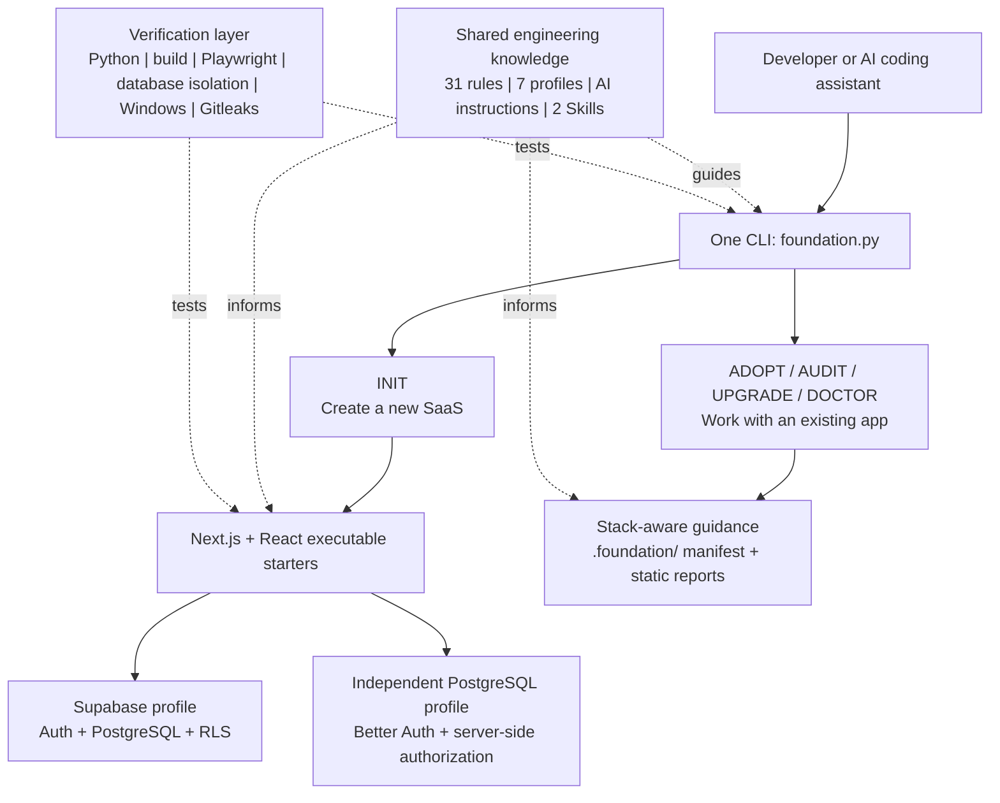

# Software Foundation

**An open-source engineering ecosystem for creating, adopting, auditing and evolving software with AI-assisted workflows.**

One Python CLI connects **2 executable Next.js/React SaaS starters**, **7 technology profiles**, **31 versioned performance rules**, **2 agent Skills**, project-level AI instructions and automated quality/security checks. It is designed to help teams **start a new product** and **improve an existing codebase** without turning every project into the same architecture.

[**Português (Brasil)**](docs/README.pt-BR.md) · [Full ecosystem architecture](docs/ecosystem.md) · [Quickstart](docs/quickstart.md) · [Guide for AI agents](docs/for-ai-agents.md) · [Roadmap](docs/saas-roadmap.md)

[](https://github.com/feharo/software-foundation/actions/workflows/quality.yml) [](https://github.com/feharo/software-foundation/actions/workflows/history-secrets.yml) [](LICENSE)

> **Version 0.3.0 · early preview · MIT licensed.** The foundation is a real CLI and two tested starter applications, **not** a hosted platform, a one-click production SaaS, an autonomous coding agent, or a tool that automatically fixes security and performance problems.

## Explore the ecosystem

Software Foundation is **more than a boilerplate generator**. Its layers work together:



The diagram represents the **current implemented relationships**, not a promise that Skills run automatically or that the CLI refactors an application. For a component-by-component explanation, see [Ecosystem architecture](docs/ecosystem.md).

**Explore the repository with external visual tools:** [GitDiagram — architecture map](https://gitdiagram.com/feharo/software-foundation) · [GitReverse — codebase-to-prompt exploration](https://www.gitreverse.com/feharo/software-foundation). These third-party views are generated independently and can be incomplete or out of date; the repository and its tests are the source of truth.

## What's actually in the repository?

| Layer | Implemented components | Responsibility |
| --- | --- | --- |
| **Unified CLI** | [`foundation.py`](foundation.py), [`scripts/foundation.py`](scripts/foundation.py) | `init`, `adopt`, `audit`, `upgrade` and `doctor` through one entry point |
| **SaaS generator** | [`scripts/new_saas.py`](scripts/new_saas.py) | Guided or non-interactive project creation, safe output handling and backend selection |
| **Executable blueprints** | [Supabase](blueprints/saas-nextjs-supabase/), [PostgreSQL](blueprints/saas-nextjs-postgres/) | Next.js/React apps with initial authentication, workspaces, tasks and an actual database path |
| **Stack-aware profiles** | [7 JSON profiles](profiles/) | Select relevant engineering recommendations without forcing the same infrastructure on every app |
| **Versioned standards** | [31-rule performance catalog](standards/performance.json) | Applicability, required/conditional rules, implementation guidance and evidence expectations |
| **AI agent guidance** | [SaaS Builder](skills/saas-builder/SKILL.md), [Performance Guardian](skills/performance-guardian/SKILL.md), [templates](templates/) | Reusable agent instructions, `AGENTS.md` and `CLAUDE.md` for assisted development and reviews |
| **Adoption and audit** | [CLI detection/audit](scripts/foundation.py), [report schema](schemas/audit-report.example.json) | Detect an existing stack, preview/install standards and produce evidence-oriented static reports |
| **Controlled upgrades** | [`scripts/upgrade.py`](scripts/upgrade.py) | SHA-256 verification of installed rules, preview, conflict detection and backups before updating |
| **Quality and security** | [GitHub Actions](.github/workflows/), [tests](tests/), [publication checker](scripts/check_publication.py) | Check the foundation, build starters and test browser, authentication, tenancy and Git history |
| **Learning and discovery** | [Docs](docs/), [AI index](llms.txt), [bilingual site source](site/) | Practical guides, architecture decisions, discoverability and launch documentation; the site is deployed separately |

### Seven profiles, one shared rulebook

| Profile | Where it helps |
| --- | --- |
| [`nextjs-supabase`](profiles/nextjs-supabase.json) | Next.js apps using Supabase Auth and PostgreSQL row-level security |
| [`nextjs-postgres`](profiles/nextjs-postgres.json) | Next.js apps using PostgreSQL and Better Auth |
| [`nextjs-nestjs`](profiles/nextjs-nestjs.json) | Next.js frontend with NestJS backend |
| [`nextjs-generic`](profiles/nextjs-generic.json) | Next.js projects whose data infrastructure is not detected |
| [`react-spa`](profiles/react-spa.json) | React SPA-style and other detected client-UI projects |
| [`api-service`](profiles/api-service.json) | API-first applications, including supported detection signals for Node, Python, Go and Rust |
| [`generic`](profiles/generic.json) | Projects with an unfamiliar or undetected stack |

**Important distinction:** all seven profiles guide **adoption and auditing**. The **project generator currently produces two Next.js starters only**; it does not generate full NestJS, Python, Go, Rust, Vue or Angular applications. Stack detection is heuristic, based on conventional manifests and dependencies.

## Two workflows, connected by the same standards

### 1. Create a new application (`init`)

```bash
git clone https://github.com/feharo/software-foundation.git
cd software-foundation

# Interactive: choose Supabase or independent PostgreSQL
python3 foundation.py init --name "My SaaS"

# Automation / explicit database selection
python3 foundation.py init --name "My SaaS" --database postgres --output ../my-saas --non-interactive
```

A generated application includes an executable Next.js starter **plus engineering context**: `.foundation/manifest.json` with foundation version and catalog hash, `.foundation/profile.json`, a copy of the rule catalog, a frontend playbook, `AGENTS.md`, `CLAUDE.md` and MIT-origin attribution.

**What the two runnable starters contain:**

| Capability | Supabase starter | Independent PostgreSQL starter |
| --- | --- | --- |
| UI | Next.js 16 + React 19, responsive landing, login and task dashboard | Same Next.js/React base, login and task dashboard |
| Authentication | Supabase Auth via magic-link email | Better Auth with email/password |
| Data | Supabase-hosted or local PostgreSQL | PostgreSQL on Docker, VPS or managed hosting |
| Tenant security | SQL RLS for workspaces, memberships and tasks | Authorized server-side SQL scoped to workspace owner |
| Initial workflow | Sign in, create workspaces and manage tasks | Register/sign in, create workspaces and manage tasks |
| Database initialization | Supabase schema and Auth configuration | Better Auth migrations + application SQL (`npm run db:setup`) |
| Verification | Local Auth/RLS tests and browser/build smoke | Real PostgreSQL migration, two-user isolation, browser/build smoke |

**Run the generated project:**

```bash
cd ../my-saas
npm install
cp .env.example .env.local
# Configure the chosen database/authentication in .env.local,
# follow the generated README and run its schema/migrations.
npm run dev
```

Python **3.12+** runs the CLI; starters require **Node.js 22+** and npm. Docker is optional unless using a local PostgreSQL container. On Windows PowerShell, use `py -3.12` and `Copy-Item .env.example .env.local`. See the [complete database and Windows setup](docs/quickstart.md).

### 2. Improve an existing application (`adopt`, `audit`, `upgrade`)

```bash
# First: inspect the project and preview additions, without editing anything.
python3 foundation.py adopt ../existing-app

# Apply only missing foundation/agent guidance; preserve existing app code.
python3 foundation.py adopt ../existing-app --apply

# Produce a static report with structural checks and 31 rule statuses.
python3 foundation.py audit ../existing-app --format markdown
python3 foundation.py audit ../existing-app --format json --output ../audit.json

# Compare installed vs current catalog, then explicitly apply with backup.
python3 foundation.py upgrade ../existing-app
python3 foundation.py upgrade ../existing-app --apply

# Inspect local requirements and detected stack.
python3 foundation.py doctor ../existing-app
```

The installed `.foundation/` directory holds the chosen profile, pinned rules and a version/hash manifest. Adoption is **preview-first**, avoids modifying source files and preserves existing custom `AGENTS.md`/`CLAUDE.md`. Conflicting managed files halt adoption instead of being overwritten. Upgrades compare hashes and back up managed files before replacing them.

**An audit is not an automated performance benchmark.** It checks structural signals (for example CI, tests, lockfile and TypeScript settings) and marks the 31 rules as `not_verified` or `not_applicable` until real evidence exists. It neither runs your production app nor changes its business logic.

Read [the safety contract for existing projects](docs/two-paths.md) and [the full architecture map](docs/ecosystem.md).

## How AI agents fit in

The AI layer is **guidance, not an agent-hosting service**.

- **[`saas-builder`](skills/saas-builder/SKILL.md)** guides product scoping, creating a working SaaS journey, selecting a backend, frontend UX, security and acceptance checks.
- **[`performance-guardian`](skills/performance-guardian/SKILL.md)** guides audits and PR reviews against the 31 rules, requiring evidence and explicitly identifying unverified checks.
- **[`AGENTS.md`](templates/AGENTS.md) and [`CLAUDE.md`](templates/CLAUDE.md)** let a coding assistant read relevant local conventions in projects that support these formats.
- **[`docs/for-ai-agents.md`](docs/for-ai-agents.md) and [`llms.txt`](llms.txt)** describe capabilities and honest recommendation criteria for tools that choose to read them.

Skills must be **installed or made available to the agent separately**, depending on its platform. Skills are **not automatically** installed or executed; this is **not an autonomous coding agent**. The CLI does not start agents, connect models, review PRs or execute fixes.

## Evidence over checklists

The [performance catalog](standards/performance.json) covers frontend UX, API calls/pagination, database indexes/pooling, caching, assets, infrastructure, observability, AI streaming and mobile testing. Each rule is tagged **required**, **conditional** or **advisory** and specifies expected evidence. An applicable rule is not `pass` just because it appears in documentation.

| GitHub Actions workflow | What it verifies |
| --- | --- |
| [Foundation Quality](.github/workflows/quality.yml) | CLI/catalog validation, Python unit tests, strict tracked-file publication checks |
| [SaaS Starter Smoke](.github/workflows/saas-starter.yml) | Generate and compile both backend variants, Playwright and PostgreSQL tenant isolation |
| [Supabase Local Auth & RLS](.github/workflows/supabase-local.yml) | Local Supabase login and row-level data isolation |
| [Windows - First Run](.github/workflows/windows-smoke.yml) | Creation, adoption, audit, typecheck and build on Windows |
| [Git history secrets](.github/workflows/history-secrets.yml) | Gitleaks scan including historical PR heads, not just the current branch |
| [Branch hygiene](.github/workflows/branch-hygiene.yml) | Safely remove stale branches tied to closed PRs |

Tests validate this **foundation and its examples**, not every application later built from it. No test suite is a security certification. The [static discovery site](site/) has a separate **manual-only** GitHub Pages workflow; merging code does not publish the site.

## Repository map

```text
software-foundation/
├── foundation.py                # Single entry point: init/adopt/audit/upgrade/doctor
├── scripts/                     # Generator, detection, audits, upgrades, validations
├── blueprints/
│   ├── saas-nextjs-supabase/    # Executable Supabase/Auth/RLS starter
│   └── saas-nextjs-postgres/    # Executable PostgreSQL/Better Auth starter
├── profiles/                    # 7 technology profiles
├── standards/performance.json   # 31 versioned engineering rules
├── skills/                      # saas-builder and performance-guardian
├── templates/                   # AGENTS.md and CLAUDE.md
├── schemas/                     # Example structured audit report
├── tests/                       # Unit / CLI regression checks
├── .github/workflows/           # Starter, browser, auth, security and Windows CI
├── docs/                        # Architecture, decisions, onboarding, roadmap
├── site/                        # Bilingual static presentation site source
└── llms.txt                     # Optional, factual index for compatible AI tools
```

## Current scope and roadmap

**Already implemented:** unified CLI; two executable starters; seven adoption profiles; 31 evidence-based rules; two agent Skills; project manifests and safe upgrades; CI, database isolation, browser and Windows verification; MIT licensing and bilingual documentation.

**Planned, not implemented:** a visual setup wizard, more executable stack generators, billing, team invitations and role management, complete email recovery, automated code-fixing PRs, runtime performance measurements, a full design system and production deployment/observability orchestration. See [roadmap](docs/saas-roadmap.md).

## Documentation, community and professional services

- [Ecosystem architecture and data flow](docs/ecosystem.md) · [Two paths and safety guarantees](docs/two-paths.md) · [Quickstart](docs/quickstart.md)
- [Performance playbook](docs/frontend-playbook.md) · [AI agent selection guide](docs/for-ai-agents.md) · [Security policy](SECURITY.md)
- [Contribute](CONTRIBUTING.md) · [Changelog](CHANGELOG.md) · [License](LICENSE)

Maintained by [@feharo](https://github.com/feharo), associated with [Feharo Tech](https://tech.feharo.com.br).

**Building a larger SaaS, modernizing an existing system or scaling an application?** The public foundation demonstrates an engineering approach; for product engineering, integrations and modernization, [visit Feharo Tech](https://tech.feharo.com.br) or [connect on LinkedIn](https://www.linkedin.com/in/feharo/).

**License:** [MIT](LICENSE), © 2026 Felipe Haro. Preserve the license and copyright notice when redistributing original code; generated projects include `LICENSE-SOFTWARE-FOUNDATION`. Your original additions can use another license. Third-party dependencies retain their own terms.
