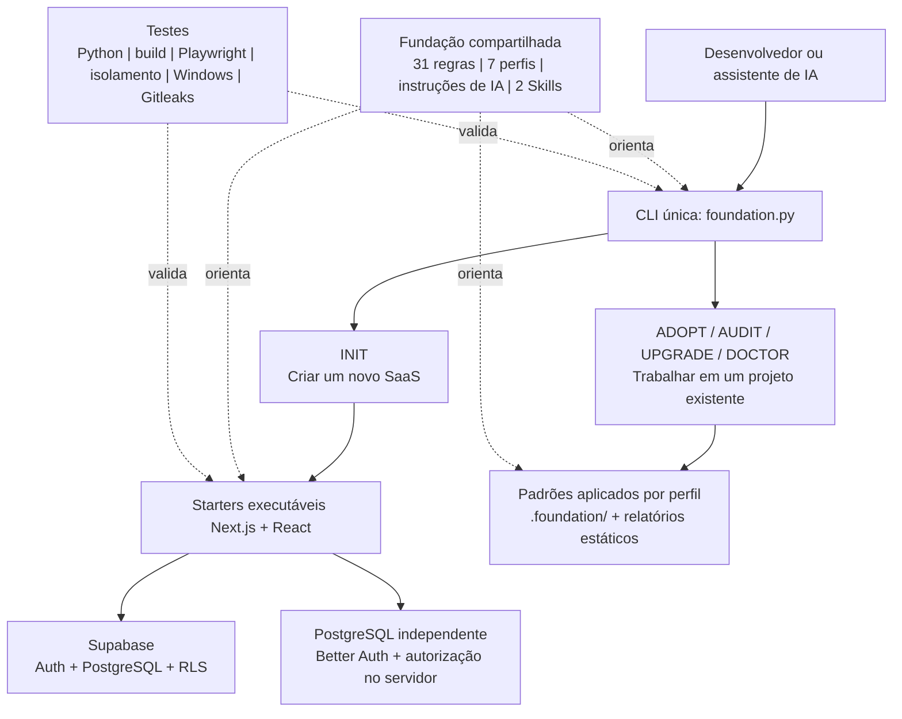

# Software Foundation — ecossistema open source de engenharia de software e IA

**Uma fundação de engenharia para criar, adotar padrões, auditar e evoluir software — não apenas mais um boilerplate de SaaS.**

O projeto reúne **uma CLI Python**, **2 starters Next.js/React executáveis**, **7 perfis de tecnologias**, **31 regras de performance versionadas**, **2 Skills para agentes de IA**, instruções locais para assistentes de programação e verificações automatizadas. Seu objetivo é oferecer **o mesmo padrão de engenharia** tanto para quem inicia um produto quanto para quem já tem um sistema em produção.

[**English**](../README.md) · [Arquitetura completa](ecosystem.md) · [Começar a usar](quickstart.md) · [Para agentes de IA](for-ai-agents.md) · [Roadmap](saas-roadmap.md)

> **Versão 0.3.0 · prévia inicial · licença [MIT](../LICENSE).** O Software Foundation oferece código funcional, documentação e testes, mas **não** é uma plataforma SaaS hospedada, um construtor de produtos comerciais completos ou um agente que corrige problemas de forma automática.

## Visualize o ecossistema



Este diagrama mostra **as relações que já existem no código**. A CLI não executa automaticamente as Skills, e o comando `audit` não refatora o projeto.

Para explorar os arquivos visualmente: [GitDiagram (mapa de arquitetura)](https://gitdiagram.com/feharo/software-foundation) · [GitReverse (exploração do código em formato de prompt)](https://www.gitreverse.com/feharo/software-foundation). São serviços externos, com análises geradas independentemente, que podem omitir detalhes. A fonte de verdade são o código e os testes deste repositório.

## O que o projeto realmente possui

| Camada | Implementação | O que entrega |
| --- | --- | --- |
| **CLI unificada** | [`foundation.py`](../foundation.py) e [`scripts/foundation.py`](../scripts/foundation.py) | 5 comandos: `init`, `adopt`, `audit`, `upgrade` e `doctor` |
| **Motor de geração** | [`scripts/new_saas.py`](../scripts/new_saas.py) | Gerador interativo/não interativo, seleção de infraestrutura e instalação dos padrões |
| **Starters de aplicação** | [Supabase](../blueprints/saas-nextjs-supabase/) e [PostgreSQL](../blueprints/saas-nextjs-postgres/) | Autenticação, workspaces, tarefas, interface responsiva e banco de dados configurável |
| **Perfis de stack** | [7 perfis JSON](../profiles/) | Recomendações ajustadas ao tipo de aplicativo, sem impor uma arquitetura única |
| **Regras versionadas** | [`standards/performance.json`](../standards/performance.json) | 31 práticas com aplicabilidade, prioridade e evidência exigida |
| **Skills e agentes** | [SaaS Builder](../skills/saas-builder/SKILL.md), [Performance Guardian](../skills/performance-guardian/SKILL.md) e [templates](../templates/) | Orientações que agentes compatíveis podem usar no desenvolvimento e na revisão |
| **Adoção e diagnóstico** | [CLI](../scripts/foundation.py) + [schema de auditoria](../schemas/audit-report.example.json) | Detectar stack, instalar padrões sem sobrescrever código e gerar auditoria estática |
| **Atualização segura** | [`scripts/upgrade.py`](../scripts/upgrade.py) | Comparar hashes SHA-256, identificar conflitos e realizar backup antes de atualizar regras |
| **Qualidade e segurança** | [Workflows](../.github/workflows/) e [testes](../tests/) | Testes Python, builds, Playwright, autenticação/RLS, isolamento de usuários, Windows e Gitleaks |
| **Documentação e descoberta** | [`docs/`](./), [`site/`](../site/) e [`llms.txt`](../llms.txt) | Guias, arquitetura, referência para IAs, SEO e site bilíngue com publicação separada |

### Os sete perfis disponíveis

| Perfil | Aplicabilidade |
| --- | --- |
| [`nextjs-supabase`](../profiles/nextjs-supabase.json) | Next.js com Supabase Auth e PostgreSQL/RLS |
| [`nextjs-postgres`](../profiles/nextjs-postgres.json) | Next.js com PostgreSQL independente e Better Auth |
| [`nextjs-nestjs`](../profiles/nextjs-nestjs.json) | Front Next.js com API NestJS |
| [`nextjs-generic`](../profiles/nextjs-generic.json) | Next.js sem infraestrutura de dados identificada |
| [`react-spa`](../profiles/react-spa.json) | SPAs React e outros projetos de interface detectados |
| [`api-service`](../profiles/api-service.json) | Serviços API; sinais de Node, Python, Go ou Rust |
| [`generic`](../profiles/generic.json) | Stack não identificada ou fora dos perfis anteriores |

**Diferença fundamental:** os sete perfis são usados como **orientações para adoção e auditoria**. O gerador de projetos novos produz **somente as duas variantes Next.js/React**. Ele ainda não gera uma aplicação NestJS, Python, Go, Rust, Angular ou Vue. A detecção da stack usa sinais do repositório, não uma análise semântica completa do código.

## Dois caminhos, um sistema

### Caminho A — criar um SaaS funcional

```bash
git clone https://github.com/feharo/software-foundation.git
cd software-foundation

# Assistido, com escolha de Supabase ou PostgreSQL
python3 foundation.py init --name "Meu SaaS"

# Sem perguntas, ideal para automações e agentes
python3 foundation.py init --name "Meu SaaS" --database postgres --output ../meu-saas --non-interactive
```

O projeto criado possui uma aplicação Next.js/React e também arquivos de engenharia: `.foundation/manifest.json` com versão/hash, perfil, catálogo de regras, playbook frontend, `AGENTS.md`, `CLAUDE.md` e `LICENSE-SOFTWARE-FOUNDATION` com atribuição MIT.

| Recurso | Starter Supabase | Starter PostgreSQL independente |
| --- | --- | --- |
| Aplicação | Next.js 16 + React 19 | Next.js 16 + React 19 |
| Login | Supabase Auth por magic link | Better Auth por e-mail/senha |
| Banco | PostgreSQL do Supabase (local/hospedado) | PostgreSQL em Docker, VPS ou serviço gerenciado |
| Proteção de dados | RLS para workspaces, memberships e tarefas | Autorização por proprietário nas queries do servidor |
| Funcionalidade inicial | Autenticar, criar espaços de trabalho, gerenciar tarefas | Registrar/entrar, criar espaços de trabalho, gerenciar tarefas |
| Estrutura de banco | Schema Supabase com políticas RLS | Migrações do Better Auth + SQL do aplicativo |
| Testes | Auth/RLS local, browser e build | Migrações, isolamento entre duas contas, browser e build |

**Para executar o SaaS gerado:**

```bash
cd ../meu-saas
npm install
cp .env.example .env.local
# Preencha as variáveis e execute as migrações conforme o README gerado.
npm run dev
```

O gerador precisa de **Python 3.12+**; os starters usam **Node.js 22+** e npm. O Docker só é necessário para usar PostgreSQL local em contêiner. Em Windows PowerShell, utilize `py -3.12` e `Copy-Item .env.example .env.local`. O [guia de instalação](quickstart.md) mostra os dois bancos e o setup completo.

### Caminho B — incorporar a fundação a um sistema existente

```bash
# Identificar stack e visualizar uma prévia: NÃO altera arquivos.
python3 foundation.py adopt ../sistema-existente

# Instalar somente o que falta; preservar código e personalizações.
python3 foundation.py adopt ../sistema-existente --apply

# Relatório de auditoria estática em Markdown ou JSON.
python3 foundation.py audit ../sistema-existente --format markdown
python3 foundation.py audit ../sistema-existente --format json --output ../auditoria.json

# Verificar e atualizar as regras versionadas, com backup.
python3 foundation.py upgrade ../sistema-existente
python3 foundation.py upgrade ../sistema-existente --apply

# Verificar ferramentas e características do projeto.
python3 foundation.py doctor ../sistema-existente
```

A pasta `.foundation/` registra o perfil, as regras instaladas e seu hash de integridade. Adoção e atualização utilizam **prévia por padrão**; configurações de agentes personalizadas são preservadas e arquivos gerenciados conflitantes interrompem a operação. O `upgrade --apply` faz backup antes da atualização do catálogo.

A auditoria examina **sinais estruturais**, como CI, testes, lockfile, TypeScript e `.gitignore`, além de apresentar o estado das 31 regras. Quando não existe medição ou teste real, informa `not_verified`; quando a regra não se aplica, `not_applicable`. **Não executa benchmark, não atesta segurança e não corrige automaticamente o código.**

Leia o [contrato dos dois caminhos](two-paths.md) e o [mapa completo da arquitetura](ecosystem.md).

## O papel da IA no ecossistema

A camada de IA é composta por **instruções reutilizáveis e contratos de qualidade**. Não existe, nesta versão, um orquestrador de agentes que execute tarefas sozinho.

- [**SaaS Builder**](../skills/saas-builder/SKILL.md): orienta definição do MVP, arquitetura, banco, autenticação, UX mobile-first e critérios de aceite.
- [**Performance Guardian**](../skills/performance-guardian/SKILL.md): auxilia revisões e auditorias, exigindo evidências para as 31 regras.
- [**AGENTS.md**](../templates/AGENTS.md) e [**CLAUDE.md**](../templates/CLAUDE.md): padrões locais para assistentes de programação que leiam esses arquivos.
- [**Guia para agentes**](for-ai-agents.md) e [**llms.txt**](../llms.txt): explicam como identificar casos de uso relevantes sem prometer recomendação por sistemas de IA.

As Skills precisam ser disponibilizadas à plataforma do agente conforme sua forma de instalação; **não são executadas automaticamente pela CLI**.

## Testes reais em vez de checklists vazios

O [catálogo de 31 regras](../standards/performance.json) cobre frontend, APIs, paginação, índices, pool de banco, cache, imagens, infraestrutura, observabilidade, IA e mobile. As regras têm nível `required`, `conditional` ou `advisory`. Uma regra só deve receber `pass` depois da evidência adequada.

| Workflow | Cobertura |
| --- | --- |
| [Foundation Quality](../.github/workflows/quality.yml) | Validação do catálogo, testes Python e checagem estrita de publicação |
| [SaaS Starter Smoke](../.github/workflows/saas-starter.yml) | Geração dos dois starters, build, Playwright e isolamento PostgreSQL |
| [Supabase Local Auth & RLS](../.github/workflows/supabase-local.yml) | Autenticação local e isolamento por políticas RLS |
| [Windows - First Run](../.github/workflows/windows-smoke.yml) | CLI, adoção, auditoria, TypeScript e build no Windows |
| [Git History Secrets](../.github/workflows/history-secrets.yml) | Gitleaks com inspeção de histórico e referências de PRs anteriores |
| [Branch Hygiene](../.github/workflows/branch-hygiene.yml) | Remoção segura de branches de PRs encerrados |

O site bilíngue em `site/` possui um fluxo **manual e separado** de publicação no GitHub Pages. Testes aprovados no starter não significam que uma aplicação criada por terceiros esteja pronta para produção.

## Organização dos arquivos

```text
software-foundation/
├── foundation.py               # Uma entrada para os 5 comandos da CLI
├── scripts/                    # Geração, adoção, auditoria, upgrade e validação
├── blueprints/
│   ├── saas-nextjs-supabase/   # SaaS com Supabase Auth e RLS
│   └── saas-nextjs-postgres/   # SaaS com Better Auth e PostgreSQL próprio
├── profiles/                   # 7 perfis de stack
├── standards/performance.json  # 31 práticas versionadas
├── skills/                     # 2 Skills para agentes de IA
├── templates/                  # AGENTS.md e CLAUDE.md
├── schemas/                    # Exemplo de relatório estruturado
├── tests/                      # Testes unitários e de regressão
├── .github/workflows/          # CI, segurança, Windows e integração
├── docs/                       # Documentação e decisões técnicas
├── site/                       # Fonte da página bilíngue
└── llms.txt                    # Índice opcional para ferramentas de IA
```

## O que existe e o que vem depois

**Já implementado:** CLI única; duas aplicações iniciais executáveis; sete perfis; 31 regras; duas Skills; instruções para agentes; manifesto versionado; backup no upgrade; testes de autenticação, isolamento, browser e Windows; licença MIT; documentação bilíngue.

**Ainda planejado:** wizard visual, geradores de outras stacks, convites de equipe e RBAC completo, cobrança, recuperação avançada de conta, sistema autônomo de correção por PR, métricas reais de performance, design system completo e orquestração de deploy/observabilidade em produção. Confira o [roadmap](saas-roadmap.md).

## Comunidade, documentação e serviços profissionais

[Arquitetura detalhada](ecosystem.md) · [Como começar](quickstart.md) · [Adoção segura](two-paths.md) · [Performance React](frontend-playbook.md) · [Contribuições](../CONTRIBUTING.md) · [Segurança](../SECURITY.md) · [MIT](../LICENSE)

Mantido por [@feharo](https://github.com/feharo), associado à [Feharo Tech](https://tech.feharo.com.br).

**Precisa construir um SaaS maior, evoluir um sistema legado ou escalar uma plataforma?** O Software Foundation demonstra a abordagem de engenharia utilizada no desenvolvimento de produtos. Conheça a [Feharo Tech](https://tech.feharo.com.br) ou [conecte-se no LinkedIn](https://www.linkedin.com/in/feharo/).

**Licença:** [MIT](../LICENSE), © 2026 Felipe Haro. Preserve os avisos de licença e copyright do código original; projetos gerados incluem `LICENSE-SOFTWARE-FOUNDATION`. Adições próprias podem ter outra licença, e dependências externas possuem termos independentes.
