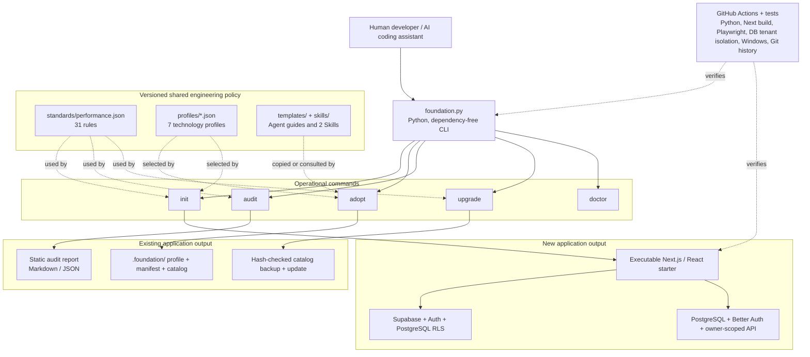
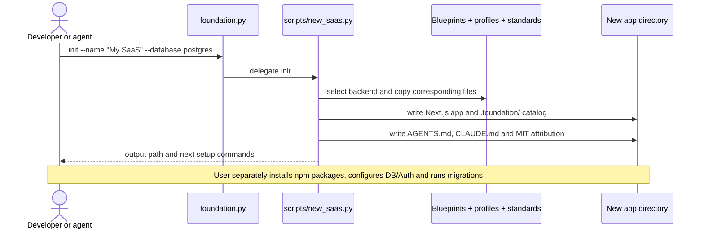
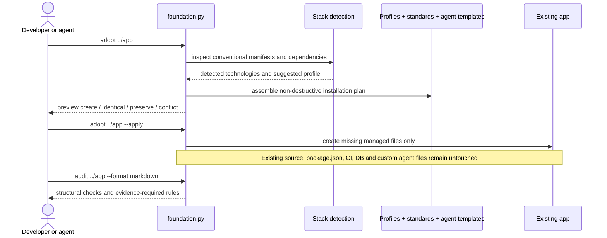

# Software Foundation: ecosystem architecture

[Back to README](../README.md) · [Português (visão geral)](README.pt-BR.md) · [CLI safety contract](two-paths.md) · [Live implementation roadmap](saas-roadmap.md)

**Source of truth:** [`foundation.py`](../foundation.py), [`scripts/`](../scripts/), [`blueprints/`](../blueprints/), [`standards/`](../standards/) and the workflows under [`.github/workflows/`](../.github/workflows/).

**Version:** `0.3.0` ([`VERSION`](../VERSION)). This is a **repository of tools, executable examples and policies**, not a central server, a SaaS hosting platform or an autonomous multi-agent orchestration product.

## 1. What kind of system is this?

The foundation is an **engineering policy-and-scaffolding system**.

A developer or compatible AI assistant can use the same repository to:

1. **Create** a new Next.js/React SaaS with a working initial auth/data path.
2. **Adopt** a shared policy catalog and agent guidance within an already-existing project, without replacing that project's code or dependencies.
3. **Audit** project structure and identify which performance criteria still require measurement or testing.
4. **Upgrade** the managed rules with hash-based conflict detection and local backups.
5. **Doctor** the local toolchain and infer technology signals.

Its value is not a single bootstrap command; the **common contract** connects generation, legacy adoption, standards, agents and validation.

## 2. Logical architecture



**Interpretation:** arrows from rules/profiles indicate guidance or data consumption, not running services. The agent Skills are **optional content**, not agents that the CLI provisions or executes. The two backend variants are **alternatives**: generating a project selects one, not both.

## 3. Execution paths

### A. Initialize an application



- The generator uses [`blueprints/saas-nextjs-supabase/`](../blueprints/saas-nextjs-supabase/) as its shared starter source and applies the independent PostgreSQL variant when selected.
- Supabase requires **Supabase Auth**, a publishable browser key, a PostgreSQL schema with **RLS policies** and email magic-link configuration.
- PostgreSQL independent requires a private `DATABASE_URL`, **Better Auth** secret/base URL, database migrations and owner-validated SQL on the Next.js server.
- The generated `.foundation/manifest.json` tracks the foundation version, selected profile and SHA-256 of the installed catalog.
- `LICENSE-SOFTWARE-FOUNDATION` preserves the MIT notice of code that originated here; the app creator can license their own additions separately.

**This step produces code and configuration — it does not provision cloud accounts, send production email, configure backups or deploy the app.**

### B. Bring an existing project under shared standards



The automatic detection recognizes conventional package and infrastructure clues including Next.js, React, NestJS, Express/Fastify, Supabase, PostgreSQL, Better Auth, Prisma/Drizzle, Vue/Angular/Svelte and Python/Go/Rust project manifests. It is a **best-effort static classification**, not deep runtime inspection.

An adoption target can end up with:

```text
your-existing-app/
├── .foundation/
│   ├── manifest.json          # Version, chosen profile, catalog SHA-256
│   ├── profile.json           # Copy of selected profile
│   ├── standards/
│   │   └── performance.json   # P001-P031, versioned guidance
│   ├── docs/
│   │   └── frontend-playbook.md
│   └── agent-guide.md
├── AGENTS.md                  # Created only when missing; user copy preserved
└── CLAUDE.md                  # Created only when missing; user copy preserved
```

If a managed file differs from the expected content, adoption reports a **conflict before modifying the project**. A second adoption with unchanged managed files is idempotent. This is not a framework migration.

### C. Produce a structural audit

[`scripts/foundation.py`](../scripts/foundation.py) inspects structural signals:

- GitHub Actions presence, test directories/files, lockfile, build/test scripts;
- TypeScript `strict` setting when a React/Next project is detected;
- `.gitignore` patterns for environment files;
- tenant isolation marked as **not verified**, because the audit does not run an application.

Every catalog entry produces an evidence-oriented result, including rule ID, category, level, expected evidence and `not_verified` / `not_applicable` status as appropriate.

A sample [report contract](../schemas/audit-report.example.json) describes `pass`, `fail`, `not_verified` and `not_applicable`. **The current CLI audit does not automatically claim `pass` for unmeasured performance.** Runtime profiling, Load testing, Core Web Vitals and security assessments remain separate work.

### D. Update the standards safely

[`scripts/upgrade.py`](../scripts/upgrade.py) is purposefully narrow:

1. Compare the existing catalog against the SHA-256 recorded in the installed manifest.
2. Compare that version to the catalog shipped with the current foundation checkout.
3. Return `up_to_date`, `update_available` or `conflict`.
4. Only on `--apply`, create `.foundation/backups/` and replace **managed catalog + manifest**.

It does **not** upgrade framework dependencies, rewrite source files, migrate databases, regenerate auth or deploy any changes. Review backups before committing consumer projects.

## 4. Components and the files that implement them

| Component | Key files | Contract |
| --- | --- | --- |
| Entry point and command parser | [`foundation.py`](../foundation.py), [`scripts/foundation.py`](../scripts/foundation.py) | Run commands locally, favor preview and reject unsafe overwrites |
| Initial SaaS generator | [`scripts/new_saas.py`](../scripts/new_saas.py) | Choose one backend; stamp profile, rule catalog and agent instructions |
| Supabase application | [`blueprints/saas-nextjs-supabase/`](../blueprints/saas-nextjs-supabase/) | Next.js/React UI, magic links, SQL RLS, workspace/task workflow |
| Independent PostgreSQL application | [`blueprints/saas-nextjs-postgres/`](../blueprints/saas-nextjs-postgres/) | Better Auth, owner-scoped Next APIs, local SQL migrations and task workflow |
| Performance rules | [`standards/performance.json`](../standards/performance.json) | 31 IDs from P001 through P031; guidance, applicability and evidence |
| Profiles | [`profiles/`](../profiles/) | 7 stack-specific mappings of recommended/conditional rules |
| Agent instruction templates | [`templates/`](../templates/) | AGENTS.md and CLAUDE.md for compatible coding agents |
| Reusable agent Skills | [`saas-builder`](../skills/saas-builder/SKILL.md), [`performance-guardian`](../skills/performance-guardian/SKILL.md) | Two Skills, manually exposed to a compatible agent |
| Catalog upgrade | [`scripts/upgrade.py`](../scripts/upgrade.py) | Check SHA-256, protect local edits and back up managed data |
| Audit data contract | [`schemas/audit-report.example.json`](../schemas/audit-report.example.json) | Expected structure of evidence-oriented rule findings |
| Developer documentation | [`docs/`](./) | Installation, security, frontend playbook, limitations and roadmap |
| Search/AI discovery | [`site/`](../site/), [`llms.txt`](../llms.txt) | Bilingual public-site source and optional reference index, not an AI ranking guarantee |

## 5. Verification and trust boundaries

The repository runs distinct automated checks:

| Workflow | Behavior validated |
| --- | --- |
| [Foundation Quality](../.github/workflows/quality.yml) | Profile/catalog validation, Python unit tests, strict pre-publication file checks |
| [SaaS Starter Smoke](../.github/workflows/saas-starter.yml) | Generate both starters, install packages, typecheck/build and browser tests, with PostgreSQL integration |
| [Supabase Local Auth & RLS](../.github/workflows/supabase-local.yml) | Local Supabase authentication, data isolation with two users |
| [Windows - First Run](../.github/workflows/windows-smoke.yml) | First-run CLI, adoption, audit, typecheck/build on Windows |
| [Histórico Git - Segredos](../.github/workflows/history-secrets.yml) | Gitleaks over reachable commits including historical PR-head references |
| [Clean old merged PR branches](../.github/workflows/branch-hygiene.yml) | Drop qualifying closed-PR branches only when current SHA still matches |
| [Publish discovery site (manual)](../.github/workflows/pages-manual.yml) | Publish the `site/` content **only after explicit owner dispatch** |

**Backend isolation is different by choice:**

- **Supabase:** the browser uses a publishable key; SQL row-level security must enforce authorization. Never expose a service-role/secret key in client code.
- **Independent PostgreSQL:** private database URL and Better Auth live server-side, and the current API routes explicitly verify the workspace owner; the starter does not rely on Supabase RLS.

The foundation does not yet offer production-ready billing, role invitations, recovery email flows, backups, application observability, breach response or compliance. Its tests prove specific **example behaviors in disposable environments**, not universal security.

## 6. Extension points

The architecture is designed to grow without mandatory complexity:

- **A new performance rule** belongs in `standards/performance.json` with applicability and evidence; update the validator, profiles and tests accordingly.
- **A new profile** belongs in `profiles/<name>.json` mapping rule IDs to an existing or detected stack. A profile **does not itself create** a runnable starter.
- **A new executable generator** requires a blueprint, explicit `init` selection and regression tests. There are currently only two variants.
- **An agent capability** belongs in the agent instructions or a separately installed Skill, with a concrete workflow and verification criteria.
- **A new automatic remediation command** would require safe diff/PR review and real tests; that behavior is **on the roadmap**, not implemented.

See [`docs/saas-roadmap.md`](saas-roadmap.md) for items that are still plans.

## 7. Visual exploration

This document is the **maintained architecture contract**. Automated external visualizers are useful additional perspectives:

- [GitDiagram — Software Foundation](https://gitdiagram.com/feharo/software-foundation): interactive architecture visualization.
- [GitReverse — Software Foundation](https://www.gitreverse.com/feharo/software-foundation): a reverse-engineered, prompt-oriented overview of the codebase.

These are **third-party tools**, not part of Software Foundation. They may sample source files, infer connections, cache older revisions or simplify away security boundaries. Confirm any important claim against the source and CI before using it in production.

## 8. Getting help, contributing and business context

- [Getting started](quickstart.md) · [Existing-project safety](two-paths.md) · [AI discovery guide](for-ai-agents.md) · [React performance playbook](frontend-playbook.md)
- [Security policy](../SECURITY.md) · [Contributing](../CONTRIBUTING.md) · [MIT license](../LICENSE)

Maintained by [@feharo](https://github.com/feharo) in association with [Feharo Tech](https://tech.feharo.com.br). For larger SaaS projects, modernization and scaling, visit [Feharo Tech](https://tech.feharo.com.br).

**Summary:** the foundation is a shared engineering **system of reusable standards, agent instructions, executable examples and evidence**, not merely a `create-app` shortcut.
